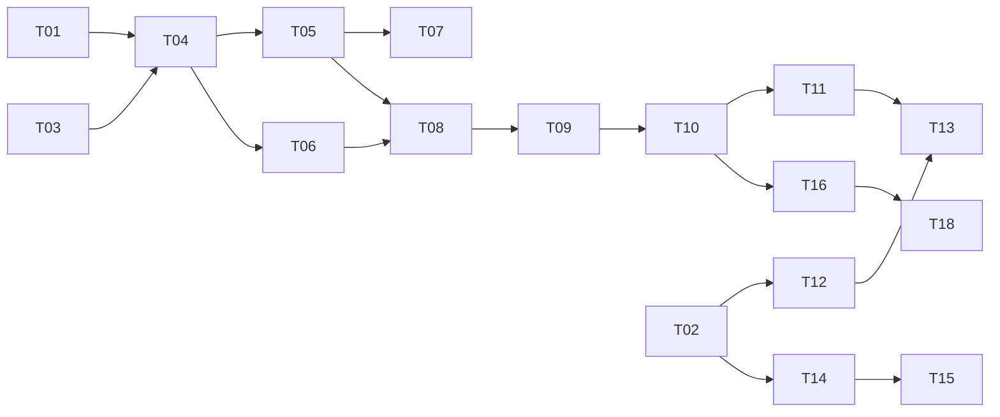

# Live play implementation plan (Keshan)

| Field | Value |
| --- | --- |
| Owner | Keshan |
| Design | `docs/ARCHITECTURE.md`, `docs/WEBSOCKET_PROTOCOL.md` (version 2, proposed), `docs/SCORING.md`, `docs/DATA_MODEL.md` |
| Jira | SCRUM-41, SCRUM-42, SCRUM-45, SCRUM-55, SCRUM-59, SCRUM-91, SCRUM-96. SCRUM-77 hosting is deferred |
| Status | Draft |
| Last updated | 2026-11-01 |
| Baseline | `origin/dev` at `6feda2f` |

This plan covers Keshan's part of the MVP: the live room core (lobby, question broadcast,
reconnect), the answer screen, the host results page, deployment and the trial data
clean up. It does not change the design. Where the design is silent or still proposed, the
plan states the assumption it uses.

## 1. Current state

What exists on `origin/dev` (checked 2026-11-01):

| Area | State | Source |
| --- | --- | --- |
| WebSocket code | None. `backend/app/ws/` is an empty folder | repo: `backend/app/ws/.gitkeep` |
| Redis | No client, no package. `REDIS_URL` is only in `.env.example` | repo: `backend/requirements.txt`, `.env.example` |
| Models | `QuizSession`, `Participant`, `Answer`, `Flag` exist with unique (session, name) and (participant, question) | repo: `backend/app/models/entities.py` |
| DB access | Synchronous SQLAlchemy 2.0, `get_db()` yields a sync `Session`, connect timeout 5 s | repo: `backend/app/db/session.py` |
| Migrations | None. Tables come from `Base.metadata.create_all` | repo: `backend/app/db/init_db.py` |
| Host auth | Stub. `current_host_id()` always returns 401 | repo: `backend/app/api/deps.py` |
| Room creation | Not on dev. PR #12 (SCRUM-40) has it on a parallel model layer and is not rebased | repo: branch `SCRUM-40_Create_room_with_code_link_and_QR` |
| Frontend | No application. Only `frontend/README.md` and empty folders, although SCRUM-14 (Vite project) is Done in Jira | repo: `frontend/` |
| Tests | pytest on in-memory SQLite, fixtures `client` and `host_client` | repo: `backend/tests/api/conftest.py` |
| CI, Docker, hosting | None | repo: no `.github/workflows`, no Dockerfile |

Fixed (constraints this plan follows):

- FastAPI WebSockets for live rooms, Redis for live room state, PostgreSQL for stored results
  (`docs/ARCHITECTURE.md` sections 2 and 5).
- Scoring arithmetic lives in services, not in `app/ws`, so it can be unit tested without a
  socket (`docs/ARCHITECTURE.md` section 4).
- 1 backend process. No background job queue and no multi process scaling in the MVP
  (`docs/ARCHITECTURE.md` section 9).
- Every message name and field comes from `docs/WEBSOCKET_PROTOCOL.md`. Nothing is invented.
- Participant names, answers and results never go to the AI provider (`CLAUDE.md` section 4).
- Hosting is paid only after decision D3 is approved (`PLAN.md`).

## 2. Scope

### In scope

| Jira | Backlog | Gantt | What Keshan delivers |
| --- | --- | --- | --- |
| SCRUM-41 | PB-15 | 7.2 | `/ws` endpoint, `join`, `leave`, `host_join`, `kick`, `lobby` broadcast |
| SCRUM-42 | PB-17 | 7.3 | `start`, `question`, `answer`, `locked`, `reveal`, `next`, `leaderboard`, `end`, `ended` game loop |
| SCRUM-45 | PB-21 | 7.6 | `rejoin`, disconnect detection, state resend after a reconnect |
| SCRUM-59 | PB-18 | 10.2 | Phone answer screen with 4 buttons and a timer (shared with 0071) |
| SCRUM-55 | PB-25 to PB-27 | 9.5 | Host page for final results, gap report and flagged questions (shared with 0071) |
| SCRUM-77 | PB-33 | 12.1 | Local network trial setup only. Hosted deployment is deferred, see below |
| SCRUM-96 | PB-34, D4 | 12.8 | Manual deletion of trial uploads and results after the trial |
| SCRUM-91 | PB-15, PB-21 | 10.7 | Shared WebSocket client. Owned by Keshan from 2026-11-01 |

### Owned by others, used through an agreed interface

| Jira | Owner | What this plan needs from it |
| --- | --- | --- |
| SCRUM-43 scoring | Isiwara, 0071 | `points_for(is_correct, answer_ms, time_limit_ms) -> int` in `backend/app/services/scoring.py` |
| SCRUM-44 leaderboard | Isiwara, 0071 | `build_leaderboard(session_id, db) -> ranked rows` with the tie break from `docs/SCORING.md` |
| SCRUM-40 room creation | Tharindu | A `sessions` row with status `waiting` and a unique 6 digit `join_code` |
| SCRUM-23, SCRUM-24 host auth | Nihansa | A function that turns a host token into a host id |
| SCRUM-47 flag and void | Sasmitha | Handlers for `flag` and `void` that plug into the message dispatch table from T04 |
| SCRUM-48, SCRUM-49, SCRUM-88 | Nihansa, Lakmal, Sasmitha | Gap report, flagged list and final results HTTP APIs for T14 and T15 |

### Deferred

| Item | Reason | Pick up when |
| --- | --- | --- |
| Hosted deployment (T17) and its hosting, domain and database cost | Not needed for now (Keshan, 2026-11-01). The trial runs on the local network setup in T16 | The team asks for a hosted trial and D3 is raised with the founder |
| Seat key on the phone to stop seat takeover | Protocol section 8 accepts name based rejoin for the MVP | Version 2, or if the trial shows name takeover |
| `room_full` limit | Number not agreed in the protocol | Load test SCRUM-69 gives a number |
| Multi process backend | Timers live in 1 process. Out of scope by `docs/ARCHITECTURE.md` section 9 | More than 1 room per class at a time is needed |
| Automatic deletion (PB-34) | Could priority, D4 open | D4 is decided and PB-34 is scheduled |
| Case insensitive unique index on `participants` | Needs a schema change through `docs/DATA_MODEL.md`. The app level check in T05 covers the MVP | A duplicate name with different case is seen in testing |

## 3. Prerequisites needing a human

| Item | Type | Owner | Status |
| --- | --- | --- | --- |
| Team confirms the 3 proposed protocol decisions dated 2026-10-26 (envelope, timer, host disconnect) in the `PLAN.md` decision log | Decision | Keshan with the team | Pending |
| Find or recreate the Vite project. SCRUM-14 is Done in Jira but no frontend code is on `dev` | Access, repo | Keshan | Pending |
| Agree the scoring and leaderboard function signatures in section 2 with Isiwara and 0071 | Decision | Keshan, Isiwara, 0071 | Pending |
| Agree the host token function with Nihansa, and that PR #12 is rebased onto `entities.py` before T06 | Decision | Keshan, Nihansa, Tharindu | Pending |
| Update the protocol doc owner line for the shared WebSocket client (10.7) from 0071 to Keshan | Docs | Keshan | Done 2026-11-01 |
| Note the SCRUM-91 swap in `docs/WORKLOG.md` at the next weekly meeting, as `CONTRIBUTING.md` asks | Docs | Keshan | Pending |
| Set the retention period for trial data (D4) | Decision | Founder | Pending |
| Redis running on each developer machine | Setup | Each developer | Assumed done with SCRUM-13 |

Nothing in this plan costs money. Hosting, domain and database costs are deferred with T17.

New free packages this plan adds, each to be explained in its pull request as `CONTRIBUTING.md`
asks: `redis` (Python client) and a WebSocket implementation for uvicorn (`websockets`) in
the backend, and a test runner for the frontend if T02 does not already add one.

## 4. Assumptions

| Assumption | Why it matters | Confidence | How to check |
| --- | --- | --- | --- |
| The protocol version 2 is accepted without field changes | Every task is built against it | Medium | Prerequisite 1 |
| Live state goes in Redis behind a small `RoomStore` interface, with an in memory version for tests | Keeps tests on SQLite with no Redis, matches the architecture | High | T03 review |
| Synchronous DB calls run in a thread from the async WebSocket handler (`run_in_threadpool`) | A blocking query inside the event loop would freeze every room | High | T04 test with a slow query |
| The lock timer is an `asyncio` task in the backend process | Matches "the server decides the lock" with 1 process | High | T08 test |
| Each question's own `time_limit` is used, not `QUESTION_TIME_LIMIT_SECONDS` | `.env.example` says 20, the model default is 30 | Medium | Ask the team in prerequisite 1 |
| Python `round()` is acceptable for the score | `docs/SCORING.md` does not name a rounding mode | Low | Owned by SCRUM-43, flag it to Isiwara |
| At the lock, every seat without an answer gets an `answers` row with `chosen_index` empty and 0 points | `docs/DATA_MODEL.md` says 1 row per participant per question | Medium | Confirm with Sasmitha (data model owner) |

## 5. Milestones

Target weeks come from the Jira dates. SCRUM-41 and SCRUM-59 were due in week 2 and SCRUM-42
in week 3, so M0 to M2 are already late and go first.

| Milestone | Outcome | Tasks | Exit criteria | Target |
| --- | --- | --- | --- | --- |
| M0 Unblock | Protocol confirmed, frontend app runs, Redis and WebSocket packages in place | T01, T02, T03 | `npm run dev` serves a page, `pytest` passes with the new `RoomStore` tests, decision log rows say Accepted | Week 4 start |
| M1 Lobby | Phones join a room and the host sees the names live | T04, T05, T06, T07 | 2 test clients join, a 3rd with the same name in other case gets `name_taken`, the host gets `lobby` with 2 names | Week 4 |
| M2 Game loop | Host runs a full quiz from start to `ended` | T08, T09, T10 | Integration test plays 2 questions with 2 participants and reaches `ended` with correct points | Week 4 |
| M3 Reconnect and phone UI | A phone can drop, rejoin and keep playing on the answer screen | T11, T12, T13 | Manual test on 1 Android and 1 iPhone: drop wifi during a question, rejoin, answer, score kept | Week 5 |
| M4 Host results | Teacher sees ranking, gap report and flagged list after the quiz | T14, T15 | Page shows data from the 3 APIs for a finished test session | Week 5 |
| M5 Trial | The trial runs on a laptop on the local network, and its data is removed after | T16, T18 | Smoke test passes on the trial setup, deletion runbook dry run shows the row counts | Week 6 |

## 6. Dependency graph

- Critical path: T01 or T03, T04, T05, T08, T09, T10, T11, T13, T16.
- Parallel tracks:
  - Backend live core: T03 to T11, all in `backend/app/ws` and `backend/app/services/live_*.py`.
  - Frontend: T02, then T12 to T15 in `frontend/src`. T12 can start against the protocol doc
    before the backend is done, using a fake server in tests.
  - Ops: T16 and T18, once M2 works. T17 is deferred.
- External blockers: T06 needs a host token function (SCRUM-23, 24 or PR #12). T09 and T10 need
  the scoring and leaderboard functions (SCRUM-43, 44). T14 and T15 need SCRUM-48, 49, 88.

## 7. Tasks

Branch per task: `type/PB-NN-short-description`, base `dev`, pull request into `dev`
(`CONTRIBUTING.md` section 2). Each task updates its Jira ticket.

### T01: Confirm the protocol decisions

- Milestone: M0
- Goal: The 3 proposed protocol decisions are Accepted in the `PLAN.md` decision log, so backend and frontend build the same thing.
- Depends on: none
- Read first: `docs/WEBSOCKET_PROTOCOL.md` sections 2, 7, 8; `PLAN.md` decision log rows dated 2026-10-26
- Touches: `PLAN.md`, `docs/WEBSOCKET_PROTOCOL.md` (status line only)
- Steps:
  1. Put the 3 rows (envelope, device timer with server lock, host disconnect waits) to the team.
  2. Ask the 2 open points from section 4: which time limit wins, and the missing answer rows at the lock.
  3. Record the result with date, who and why. Change the protocol status from proposed to accepted.
- Acceptance criteria:
  - [ ] 3 decision log rows say Accepted with a date and names.
  - [ ] The protocol header says version 2, accepted.
  - [ ] Any change to a field goes in through a pull request, as `CLAUDE.md` section 2 requires.
- Tests: none, documentation only
- Links: SCRUM-17, PLAN.md section 6
- Size: S
- Risk: The team changes a field. Fallback: update the doc first, then start T04.
- Status: Todo

### T02: Get the frontend app running

- Milestone: M0
- Goal: `frontend/` has a Vite React app with routing and the 2 `VITE_` variables, so T12 to T15 have somewhere to live.
- Depends on: none
- Read first: `frontend/README.md`, `docs/ARCHITECTURE.md` section 4 (page list), `.env.example` frontend block
- Touches: `frontend/package.json`, `frontend/vite.config.*`, `frontend/src/main.*`, `frontend/src/pages/`
- Steps:
  1. Check whether the SCRUM-14 work exists on another branch or machine. If it does, open its pull request into `dev` and stop here.
  2. If not, create the Vite React project in `frontend/`, add a router with empty pages for `/join`, `/play`, `/host/results/:sessionId`.
  3. Read `VITE_API_BASE_URL` and `VITE_WS_BASE_URL` in 1 config file.
  4. Add a component test runner and 1 smoke test.
  5. Note in the pull request that SCRUM-14 was marked Done without code on `dev`.
- Acceptance criteria:
  - [ ] `npm install` and `npm run dev` start the app and `/join` renders.
  - [ ] `npm test` runs 1 passing test.
  - [ ] No secret or real URL is committed. Only `VITE_` names are read.
- Tests: 1 smoke render test
- Links: SCRUM-14, SCRUM-59, SCRUM-55
- Size: S
- Risk: Other members start their own scaffold at the same time. Fallback: announce in the team chat before starting and merge this first.
- Status: Todo

### T03: Live room store and packages

- Milestone: M0
- Goal: A `RoomStore` with a Redis version and an in memory version holds live room state, with timeouts and a retry limit on Redis.
- Depends on: none
- Read first: `docs/ARCHITECTURE.md` section 5 (what lives in Redis), section 7 (Redis failure row); `backend/app/db/session.py` for the timeout style
- Touches: `backend/requirements.txt`, `backend/app/services/live_store.py` (new), `backend/tests/unit/test_live_store.py` (new)
- Steps:
  1. Add pinned `redis` and `websockets` to `requirements.txt`. Do not change other pins.
  2. Define `RoomStore` with: set and get phase, current question index and `sent_at`, seat connected flag, answered set for the current question, connection to seat map, clear room.
  3. Write `RedisRoomStore` with connect and socket timeouts and at most 3 retries on connection errors. Keys are prefixed by session id and expire when the session ends.
  4. Write `MemoryRoomStore` for tests.
  5. Fail loudly when Redis is down at room start, as the architecture failure table says.
  6. Log each Redis call that fails: what was tried, the error, and that it was skipped or retried.
- Acceptance criteria:
  - [ ] The same test suite passes against `MemoryRoomStore`, and against `RedisRoomStore` when `REDIS_URL` is set.
  - [ ] With Redis stopped, opening a room raises a clear error within the connect timeout and logs it.
  - [ ] Marking a seat answered twice returns "already answered" the second time.
- Tests: unit tests on both stores, Redis tests skipped when `REDIS_URL` is not set
- Links: ARCHITECTURE section 5, org rule on timeouts and retries
- Size: M
- Risk: Clash with PR #12's `core/config.py`. Fallback: read `REDIS_URL` with `os.getenv` in this module and move it into the shared config after PR #12 merges.
- Status: Todo

### T04: WebSocket endpoint and message dispatch

- Milestone: M1
- Goal: `/ws` accepts connections, validates the envelope and routes each message type to a handler, following protocol sections 1 and 2.
- Depends on: T01, T03
- Read first: `docs/WEBSOCKET_PROTOCOL.md` sections 1, 2, 4 (error), 5
- Touches: `backend/app/ws/endpoint.py` (new), `backend/app/ws/connections.py` (new), `backend/app/ws/messages.py` (new), `backend/app/main.py`, `backend/tests/api/test_ws_envelope.py` (new)
- Steps:
  1. Add `/ws` to the app. Keep a connection registry per session.
  2. Reject messages over 2 KB, invalid JSON, unknown types and wrongly typed fields with `bad_message` and keep the connection open.
  3. Return `not_joined` when the first message is not `join`, `rejoin` or `host_join`.
  4. Dispatch by `type` through a table, so `flag` and `void` from SCRUM-47 can be added without editing the loop.
  5. Run DB work in a thread with `run_in_threadpool` so the event loop never blocks.
  6. Log every message: type, session id, result, and anything ignored.
- Acceptance criteria:
  - [ ] `{"type":"answer"}` as a first message returns `error` with code `not_joined`.
  - [ ] A 3 KB message returns `bad_message` and the next valid message still works.
  - [ ] An unknown extra field is ignored.
- Tests: API tests with FastAPI `TestClient.websocket_connect`
- Links: SCRUM-41, protocol sections 1 and 2
- Size: M
- Risk: TestClient WebSocket tests with threads and SQLite. Fallback: use a file backed SQLite in these tests, as PR #12 does.
- Status: Todo

### T05: Participant join, leave and lobby

- Milestone: M1
- Goal: A participant joins with a code and a name, and everyone in the room gets an updated `lobby`.
- Depends on: T04
- Read first: protocol section 3 (`join`, `leave`, display name rules), section 4 (`joined`, `lobby`); `docs/DATA_MODEL.md` participants
- Touches: `backend/app/services/live_lobby.py` (new), `backend/app/ws/handlers/lobby.py` (new), tests
- Steps:
  1. Find the session by `join_code`. No session gives `room_not_found`, status `ended` gives `room_closed`, status `running` gives `wrong_phase`.
  2. Trim the name and check 1 to 20 characters, else `name_invalid`.
  3. Compare names without case against the session's participants, else `name_taken`. Keep the DB unique constraint as the last guard.
  4. Insert the `participants` row, mark the seat connected in the store, reply `joined` with `rejoined: false` and `score: 0`.
  5. Send `lobby` to everyone in the room in join order.
  6. On `leave` or a dropped connection, mark the seat disconnected and send `lobby`.
- Acceptance criteria:
  - [ ] Wrong code returns `room_not_found` (TASKS 3.5.2 done check).
  - [ ] "Ana" then "ana" in the same room: the second gets `name_taken`.
  - [ ] 2 joins produce a `lobby` with `count: 2` on both connections.
  - [ ] A name of 21 characters returns `name_invalid`.
- Tests: service unit tests, WebSocket API tests that create the session row directly in the fixture
- Links: SCRUM-41, PB-15
- Size: M
- Risk: 2 joins with the same name in different case at the same moment. Fallback: a per session `asyncio.Lock` around the check and insert, since there is 1 process.
- Status: Todo

### T06: Host join for control and big screen

- Milestone: M1
- Goal: A host screen connects with its token, the server checks ownership and sends `host_joined` and the current state.
- Depends on: T04, agreed host token function
- Read first: protocol section 3 (`host_join`), section 7 rule 6; `backend/app/api/deps.py`
- Touches: `backend/app/ws/handlers/host.py` (new), `backend/app/ws/auth.py` (new), tests
- Steps:
  1. Wrap the token check in 1 function `host_id_from_token(token)` so the real one from SCRUM-23 or PR #12 drops in.
  2. Check that the session's quiz belongs to that host, else `unauthorised`.
  3. Reply `host_joined` with `screen`, `quiz_title`, `join_code`, `status`, then the state message for the current phase.
  4. Check the token again on every host message (`start`, `next`, `end`, `void`, `kick`).
- Acceptance criteria:
  - [ ] Valid token for the owner gets `host_joined` then `lobby`.
  - [ ] A token for another host gets `unauthorised` and no state.
  - [ ] A missing token on `start` gets `unauthorised`.
- Tests: API tests overriding `host_id_from_token`, as `host_client` does for HTTP
- Links: SCRUM-41, protocol rule 6
- Size: S
- Risk: Host auth is not merged in time. Fallback: merge with the override only, and mark host flows untestable by hand until auth lands.
- Status: Todo

### T07: Kick a participant from the lobby

- Milestone: M1
- Goal: The host removes a participant in the waiting phase.
- Depends on: T05, T06
- Read first: protocol section 3 (`kick`), section 4 errors
- Touches: `backend/app/ws/handlers/host.py`, `backend/app/services/live_lobby.py`, tests
- Steps:
  1. Accept `kick` only in waiting, else `wrong_phase`.
  2. Send `removed_by_host` to the kicked phone and close it.
  3. Delete the participant row and the seat, then send `lobby` to everyone.
- Acceptance criteria:
  - [ ] Kicked phone gets `error` `removed_by_host` and the socket closes.
  - [ ] Others get `lobby` without that name.
  - [ ] `kick` after `start` returns `wrong_phase`.
- Tests: API tests
- Links: SCRUM-41, SCRUM-90 (host controls UI)
- Size: S
- Risk: Low.
- Status: Todo

### T08: Start the quiz and broadcast the question

- Milestone: M2
- Goal: `start` moves the session to running and sends the first `question` to every device at the same time, with a server lock timer.
- Depends on: T05, T06
- Read first: protocol sections 3 (`start`), 4 (`question`, `locked`), 5, 7 rules 1 to 4 and 9
- Touches: `backend/app/services/live_game.py` (new), `backend/app/ws/handlers/game.py` (new), tests
- Steps:
  1. `start` in waiting only. No connected participants gives `no_participants`.
  2. Set `sessions.status` to running and `started_at`. Load the quiz questions in id order.
  3. Build `question` without the correct option. `sent_at` is server time in ms, `remaining_ms` equals `time_limit_ms`.
  4. Store phase, index and `sent_at`. Send 1 broadcast.
  5. Start an `asyncio` task that locks the question after `time_limit_ms` and sends `locked` with reason `timer`.
- Acceptance criteria:
  - [ ] Each connection receives exactly 1 `question` per question (TASKS 3.5.3).
  - [ ] No `question` message contains `correct_index`.
  - [ ] With a 1 s time limit in the test, `locked` with reason `timer` arrives after about 1 s.
- Tests: service unit tests with a fake clock, 1 API test with a short time limit
- Links: SCRUM-42, PB-17
- Size: M
- Risk: Slow broadcast to 30 sockets skews fairness. Fallback: send with `asyncio.gather` and log the spread between first and last send.
- Status: Todo

### T09: Receive answers and lock early

- Milestone: M2
- Goal: Each participant's first answer is recorded with server measured time and points, and the question locks when all connected participants have answered.
- Depends on: T08, scoring function from SCRUM-43
- Read first: protocol section 3 (`answer`), 4 (`ack`, `answer_count`), 7 rules 2 and 4; `docs/SCORING.md`
- Touches: `backend/app/services/live_game.py`, `backend/app/ws/handlers/game.py`, tests
- Steps:
  1. Accept `answer` only in the question phase and only for the current `question_id`. Others are ignored and logged as skipped.
  2. Mark answered in the store. A second answer gets no reply.
  3. `answer_ms` is the server receive time minus `sent_at`. Call `points_for` from SCRUM-43.
  4. Write the `answers` row in a thread. Reply `ack`, send `answer_count` to host screens.
  5. If every connected participant has answered, cancel the timer and send `locked` with reason `all_answered`.
- Acceptance criteria:
  - [ ] 2 answers from 1 phone produce 1 row and 1 `ack`.
  - [ ] An answer after `locked` scores 0 and gets no `ack`.
  - [ ] 2 of 2 answered gives `locked` with `all_answered` before the timer.
  - [ ] DB write failure: the phone gets no `ack`, the error is logged with participant and question ids.
- Tests: unit tests with a fake clock and a stub `points_for`, API tests
- Links: SCRUM-42, SCRUM-43, PB-19
- Size: M
- Risk: SCRUM-43 not ready. Fallback: a stub that returns 0 behind the same signature, swapped when it merges.
- Status: Todo

### T10: Reveal, leaderboard, next and end

- Milestone: M2
- Goal: The host steps through reveal, leaderboard and the next question until `ended`.
- Depends on: T09, leaderboard function from SCRUM-44
- Read first: protocol sections 3 (`next`, `end`), 4 (`reveal`, `leaderboard`, `ended`), 5
- Touches: `backend/app/services/live_game.py`, `backend/app/ws/handlers/game.py`, tests
- Steps:
  1. At the lock, write empty answer rows with 0 points for seats that did not answer (see the assumptions in section 4).
  2. Send `reveal` with `correct_index`, `distribution`, `no_answer`, `source`, and `you` to each participant.
  3. `next` in reveal sends `leaderboard` (top 10, `count`, `you`). `next` in leaderboard sends the next question or `ended` after the last.
  4. `end` from any phase sends `ended` with reason `ended_by_host`.
  5. On `ended`, set `sessions.status` and `ended_at`, cancel timers and clear the room from the store.
- Acceptance criteria:
  - [ ] A 2 question test game ends with `ended` reason `finished` and `sessions.status = 'ended'`.
  - [ ] Each phone's `reveal` has its own `you`, and no phone sees another's.
  - [ ] `next` during the question phase returns `wrong_phase`.
  - [ ] After `ended`, any message gets `room_closed`.
- Tests: 1 integration test that plays a full game with 2 participants and 1 host
- Links: SCRUM-42, SCRUM-44, PB-17, PB-20
- Size: L, split into reveal (T10a) and leaderboard plus end (T10b) if the pull request grows past about 400 lines
- Risk: Leaderboard not ready. Fallback: stub ranking by points only, swapped when SCRUM-44 merges.
- Status: Todo

### T11: Rejoin the same seat

- Milestone: M3
- Goal: A disconnected participant gets their seat and score back and receives the current state.
- Depends on: T10
- Read first: protocol section 3 (`rejoin`), 6, 8 notes; `docs/SCORING.md` reconnect rule
- Touches: `backend/app/services/live_lobby.py`, `backend/app/ws/handlers/lobby.py`, uvicorn run settings, tests
- Steps:
  1. Find the seat by code and name without case. None gives `seat_not_found`, a connected seat gives `seat_in_use`.
  2. Reconnect the seat, reply `joined` with `rejoined: true` and the current score.
  3. Send 1 state message for the phase. In the question phase, `remaining_ms` is `time_limit_ms` minus the time since `sent_at`, not below 0.
  4. A rejoin in the question phase can still answer, timed from the original `sent_at`.
  5. Set the uvicorn WebSocket ping interval and timeout so dropped phones are found, and write the values in `docs/SETUP.md`.
- Acceptance criteria:
  - [ ] Disconnect during question 2, rejoin: `joined` shows the score from question 1, then `question` with a smaller `remaining_ms`.
  - [ ] Missed questions score 0 (TASKS 3.5.6).
  - [ ] Rejoin for a connected seat gets `seat_in_use`.
  - [ ] Host screen reconnect with `host_join` gets the current state.
- Tests: API tests that close and reopen a client mid game
- Links: SCRUM-45, PB-21
- Size: M
- Risk: Ping settings too slow, so the old seat still looks connected. Fallback: lower the ping timeout and test on a phone switching wifi off.
- Status: Todo

### T12: Shared WebSocket client

- Milestone: M3
- Goal: 1 browser client connects, sends and receives protocol messages and rejoins after a drop.
- Depends on: T02
- Read first: protocol sections 1, 2, 6; `frontend/README.md` rules
- Touches: `frontend/src/lib/wsClient.*` (new), `frontend/src/hooks/useRoom.*` (new), tests
- Steps:
  1. Connect to `VITE_WS_BASE_URL` plus `/ws`. Send and parse the envelope.
  2. Register handlers by message type. Ignore unknown types.
  3. Keep the join code and name in session storage. On a drop, retry `rejoin` with backoff and at most 5 attempts, then show "Connection lost".
  4. Log each attempt and result to the console in development only.
- Acceptance criteria:
  - [ ] Against a fake server, a dropped socket triggers `rejoin` with the stored code and name.
  - [ ] After 5 failed attempts the client stops and reports the failure.
  - [ ] Message names match `docs/WEBSOCKET_PROTOCOL.md` exactly.
- Tests: unit tests with a fake WebSocket
- Links: SCRUM-91, PB-15, PB-21
- Size: M
- Risk: Join page (Tharindu) and big screen (Dulanjana) build their own socket code before this lands. Fallback: tell them the client's handler API in the team chat when T12 starts.
- Status: Todo

### T13: Answer screen

- Milestone: M3
- Goal: The phone shows 4 answer buttons and a countdown, and allows 1 answer only.
- Depends on: T12, T11 for the end to end check
- Read first: protocol rule 9, `question`, `ack`, `locked`, `reveal`; TASKS 4.2.2 done check; wireframes from SCRUM-20
- Touches: `frontend/src/pages/Play.*` (new), `frontend/src/components/AnswerButtons.*` (new), `frontend/src/hooks/useCountdown.*` (new), tests
- Steps:
  1. On `question`, show the text and 4 buttons, and count down from `remaining_ms`.
  2. On tap, send `answer` and disable all buttons at once. Show "Answer sent" on `ack`.
  3. Disable buttons at 0 or on `locked`, whichever comes first.
  4. On `reveal`, show the participant's result from `you`.
  5. Phone first layout. Buttons large enough to tap on a small screen.
- Acceptance criteria:
  - [ ] Second tap sends nothing (TASKS 4.2.2).
  - [ ] Buttons are disabled when the countdown reaches 0 even if `locked` is late.
  - [ ] Works on Chrome Android and Safari iPhone, checked by hand and noted in the pull request.
- Tests: component tests for 1 answer only and timer disable, manual phone check
- Links: SCRUM-59, PB-18
- Size: M
- Risk: Phone clock drift. No risk to scoring because the server measures time. The display may be off by the network delay, which is accepted by protocol rule 9.
- Status: Todo

### T14: Final results and gap report page

- Milestone: M4
- Goal: The host sees the full ranking, percent correct per question and the gap report for a finished session.
- Depends on: T02, SCRUM-88 (results API), SCRUM-48 (gap report API), host login pages from SCRUM-51
- Read first: `docs/DATA_MODEL.md` section 4, `docs/SCORING.md` void rule, TASKS 4.1.5
- Touches: `frontend/src/pages/HostResults.*` (new), `frontend/src/lib/api.*`, tests
- Steps:
  1. Load results and gap report with a timeout and at most 2 retries. Show an error message on failure.
  2. Show the ranking and percent correct per question. Mark voided questions as voided.
  3. Show the gap report sorted worst first with "No source" as its own group.
- Acceptance criteria:
  - [ ] Gap report rows are in descending percent wrong order.
  - [ ] A voided question shows the voided marker and no percentage.
  - [ ] API down: the page shows an error and a retry button, not a blank page.
- Tests: component tests with mocked API responses
- Links: SCRUM-55, PB-25, PB-26
- Size: M
- Risk: APIs late. Fallback: build against the response shapes agreed with their owners, using mocked data.
- Status: Todo

### T15: Flagged questions list

- Milestone: M4
- Goal: The host sees each flagged question with its flag count and opens it in edit mode.
- Depends on: T14, SCRUM-49 (flagged list API), SCRUM-53 (question review page)
- Read first: TASKS 3.6.3 and 4.1.5
- Touches: `frontend/src/pages/HostResults.*`, `frontend/src/components/FlaggedList.*` (new), tests
- Steps:
  1. Load the flagged list for the session.
  2. Show question text and flag count, highest count first.
  3. Each row links to the question review page in edit mode.
- Acceptance criteria:
  - [ ] Clicking a row opens the review page for that question id.
  - [ ] An empty list shows "No flagged questions".
- Tests: component test with mocked API
- Links: SCRUM-55, PB-27
- Size: S
- Risk: Review page route not agreed. Fallback: agree the path with Vishmi before starting.
- Status: Todo

### T16: Local network trial setup

- Milestone: M5
- Goal: The whole app runs on 1 laptop and phones on the same network can play. This is the trial setup while hosting is deferred.
- Depends on: T10, T13
- Read first: `PLAN.md` section 7 risk 3, `docs/SETUP.md`
- Touches: `docs/SETUP.md`, `.env.example` if a variable is missing
- Steps:
  1. Run the backend on the laptop's network address, with the frontend built and pointed at it.
  2. Write the exact steps and env variables in `docs/SETUP.md`.
  3. Play 1 full quiz with at least 3 phones and note the result in `docs/WORKLOG.md`.
- Acceptance criteria:
  - [ ] A phone on the same wifi joins by code and finishes a quiz.
  - [ ] Setup steps work when another member follows them on their machine.
- Tests: manual run, recorded in the worklog
- Links: SCRUM-77, PLAN.md risk 3
- Size: S
- Risk: School wifi blocks device to device traffic. Fallback: a phone hotspot from the laptop.
- Status: Todo

### T17: Deploy to hosting (deferred)

Deferred on 2026-11-01. Hosting and database costs are not needed for now. The task stays
here so it can be picked up without re-planning.

- Milestone: none while deferred
- Goal: The app runs on the approved host with every secret from environment variables.
- Depends on: T16, D3 approval
- Read first: `PLAN.md` D3, `docs/ARCHITECTURE.md` section 8, `.env.example`
- Touches: deployment config for the chosen host, `docs/SETUP.md`
- Steps:
  1. Only after D3 is approved in writing. Record the choice in the decision log.
  2. Provision PostgreSQL and Redis. Set every variable from `.env.example` on the host, none in the repo.
  3. Serve the frontend over HTTPS and the WebSocket over `wss://`.
  4. Add a health check route and check it after deploy.
  5. Run the T16 smoke test against the hosted address.
- Acceptance criteria:
  - [ ] `git grep` finds no secret values. The host's settings list every `.env.example` name.
  - [ ] A phone on mobile data joins and finishes a quiz.
  - [ ] Redis stopped on the host: creating a room fails with a clear error, not mid game.
- Tests: smoke test checklist in the pull request
- Links: SCRUM-77, PB-33, D3
- Size: M
- Risk: D3 not approved by week 6. Fallback: run the trial with T16.
- Status: Deferred

### T18: Trial data deletion runbook

- Milestone: M5
- Goal: After the trial, its uploads and results are deleted by hand in a safe, checked order.
- Depends on: T16, D4 decision
- Read first: `docs/DATA_MODEL.md` sections 3 and 5, D4 in `PLAN.md`
- Touches: `docs/SETUP.md` or a new `docs/TRIAL_CLEANUP.md`, an SQL script under `backend/app/db/`
- Steps:
  1. Write a script that first counts the rows it would delete for the trial host ids: answers, flags, participants, sessions, questions, quizzes, material pages, materials.
  2. Delete in that order inside 1 transaction, because sessions block quiz deletion.
  3. Delete the uploaded files under `UPLOAD_DIR` for those materials.
  4. Take a backup first and keep it only as long as D4 allows.
  5. Record what was deleted, when and by whom in `docs/WORKLOG.md`.
- Acceptance criteria:
  - [ ] Dry run prints counts and changes nothing.
  - [ ] After the run, the counts for the trial hosts are 0 and other hosts' data is unchanged.
- Tests: run against a local copy with synthetic data first
- Links: SCRUM-96, PB-34, D4
- Size: S
- Risk: Deleting the wrong host's data. Fallback: the script takes explicit host ids and refuses to run without them.
- Status: Todo

## 8. Data migrations

No schema change is planned in Keshan's tasks. The tables in `entities.py` already have what
the live loop needs, and live state stays in Redis.

| Migration | Type | Task | Reversible | Notes |
| --- | --- | --- | --- | --- |
| None | n/a | n/a | n/a | If a case insensitive name index or a voided marker is needed, it goes through `docs/DATA_MODEL.md` by pull request. The voided marker belongs to SCRUM-47 |

## 9. Rollout and rollback

There is no production yet. Every task merges into `dev`. `dev` reaches `main` through the
team's release pull request.

| Milestone | Rollout | Check after merge | Rollback |
| --- | --- | --- | --- |
| M0 to M2 | Merge into `dev` | Full `pytest` passes on `dev` after the merge | Revert the merge commit on `dev` |
| M3, M4 | Merge into `dev` | Manual phone check written in the pull request | Revert the merge commit |
| M5 | Laptop setup on the local network | Smoke quiz with 3 phones | Stop the laptop process. No shared data affected |

## 10. Observability

| Milestone | Logs | Metrics |
| --- | --- | --- |
| M0 | Redis calls that fail: attempted, error, retried or skipped | none |
| M1 | Each WebSocket message: type, session id, result. Joins rejected with their error code | Connected count per room in `answer_count` |
| M2 | Question sent with `sent_at`, lock with reason, answers ignored after the lock | Time between first and last `question` send per broadcast |
| M3 | Rejoin attempts and results, seats marked disconnected | none |
| M5 | Deploy steps, health check result, cleanup counts | none |

Logs never include answer text or names in a form sent to any external service.

## 11. Definition of done

Applies to every task, on top of `PLAN.md` section 6:

- [ ] Acceptance criteria met and checked
- [ ] Tests added and passing locally. There is no CI on `dev` yet
- [ ] New network calls have a timeout, a retry limit and logs
- [ ] No secrets or real user data committed
- [ ] Protocol, setup and plan docs updated where behaviour changed
- [ ] Reviewed by 1 team member and merged into `dev`
- [ ] Jira ticket moved to the matching status

## 12. Risks to the plan

| Risk | Effect | Mitigation |
| --- | --- | --- |
| Protocol fields change after T04 starts | Rework in backend and frontend | T01 first. Any change by pull request to the protocol doc |
| No frontend app on `dev` | T12 to T15 cannot start | T02 in week 4 day 1 |
| Host auth not merged | Host flows only testable with an override | T06 uses 1 swappable function |
| PR #12 merges with its parallel model layer | 2 `sessions` models, broken imports | Rebase PR #12 onto `entities.py` before T08 |
| Scoring and leaderboard late | Game loop gives 0 points | Stubs behind agreed signatures |
| Already 1 to 2 weeks behind on SCRUM-41, 42, 59 | Week 4 is overloaded | Backend live core first. Ask 0071 to take T13 or T14 |
| Blocking DB calls in the WebSocket handler | All rooms freeze under load | `run_in_threadpool` in T04, load test by SCRUM-69 |
| Trial venue network blocks phone to laptop traffic | Local trial cannot run | Test the venue wifi early, phone hotspot as backup (T16) |

## Progress log

| Date | Task | Change |
| --- | --- | --- |
| 2026-11-01 | all | Plan created from `origin/dev` at `6feda2f` |
| 2026-11-01 | T12, T17 | Keshan owns SCRUM-91, so T12 is no longer conditional. Hosted deployment and its costs deferred |
| 2026-11-08 | T04 to T07, T11 in part | `/ws` built in `backend/app/ws` with `join`, `rejoin`, `host_join`, `kick`, `leave` and `lobby`. Live state is in memory in 1 process, the Redis `RoomStore` of T03 is still Todo. Publish endpoint `POST /api/quizzes/{id}/sessions` added for the lobby, overlapping SCRUM-40 |
| 2026-11-12 | T08 to T10, T11 in part | `start`, `question`, `answer`, `locked`, `reveal`, `next`, `leaderboard`, `end` and `ended` built in `backend/app/ws`. Game state is in memory in 1 process like the lobby. A rejoin or host_join gets the current phase message. Host Start, Next and End controls and the phone answer screen added. `flag` and `void` still answer `wrong_phase` |
